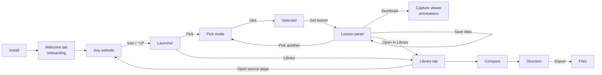

# Pixel Peeper — user flow v2 (proposal)

Status: agreed direction (2026-10-13). Decisions in §8. Extends `docs/design/flow.md`; where they disagree, this is newer.
No accounts. Everything is stored locally in the browser. (Notion export is planned for later.)

## 1. Job story

> When I notice a website detail that works (or doesn't), I want to understand **why**, keep it **with its source**, and **reuse** the idea in my own work.

Success: the user can pick something in under 5 seconds, read the lesson in under a minute, find it again next week by site or pattern, and turn two or three ideas into a direction they can export.

## 2. Objects and vocabulary (fix these first)

The current build blurs these, which is why "getting back to things" feels scattered.

| Object | What it is | Label | Lives in |
|---|---|---|---|
| **Capture** | What was selected: element or visible page, its screenshot, page info, measured facts, rule results, annotation geometry | Measured | Created on pick |
| **Lesson** | AI interpretation of one capture | Inferred | Attached to a capture |
| **Idea** | A capture + lesson the user chose to keep, plus title, note, collection | Both, plus *User authored* (title, note) | Library |
| **Recent** | Captures from the last 7 days that were not saved (max 20) | Both | Library → Recent |
| **Collection** | A named group of ideas, e.g. "Pricing pages" | User authored | Library |
| **Comparison** | 2–3 ideas side by side | Measured diffs + Inferred read-across | Library → Compare |
| **Direction** | Values borrowed from ideas + rationale, ready to export | Measured values, Inferred/User rationale | Library → Direction |

UI words: "Pick", "Get lesson", "Lesson", "Save idea", "Library", "Recent", "Compare", "Direction", "Bigger / Smaller". Retire "Scan selection", "Saved ideas", "Parent/Child".

## 3. Where things live (recommended concept)

Two surfaces with a clean split:

- **On the page (overlay):** fast, in-context work. Launcher, pick mode, lesson panel, capture viewer.
- **Library tab (full browser tab, extension page):** everything after the moment. Browse, search, compare, direction, export, settings.

Why: the floating panel is too small for compare and export, and the library must work from any tab, including when no page is inspectable. The overlay stays light; the library has room.

Rejected: *everything in the overlay* (cramped, compare unusable at 390px); *side panel* (spec rule: never shrink the website).



## 4. Breadboards

### 4.1 Onboarding (first install, once)

Opens automatically in a new tab after install (`chrome.runtime.onInstalled`). Every step is skippable; nothing blocks use.

```
Welcome · 1 What it does
[ one sentence: "Inspect Element for design language" ]
[ a sample lesson card with Measured and Inferred labels explained ]
- Next → Welcome · 2
- Skip setup → Welcome · 4

Welcome · 2 What do you want from it?          (expectations; stored locally)
[ goals, multi-select: Learn why designs work · Build a reference library ·
  Check accessibility · Pull tokens for my own work ]
[ level: Student · Practising designer · Senior / lead ]
- Next → Welcome · 3

Welcome · 3 Lessons need an AI key (optional)
[ provider choice, key field, "what is sent" disclosure ]
- Save and test → (test call) ✓ → Welcome · 4 | ✗ → inline error, stay
- Measure-only for now → Welcome · 4

Welcome · 4 Try it
[ "Pin Pixel Peeper" with arrow to the puzzle menu ]
[ shortcut ⌥P ]
- Open a practice page → bundled demo page with coach marks
- Done → close tab
```

How expectations are used (all local):
- *Learn why* → Lesson tab first, fuller explanations.
- *Reference library* → Save prompt more prominent, auto-suggest collection.
- *Check accessibility* → Rules tab opens first; failures summarised in the lesson headline area.
- *Pull tokens* → "Add to direction" shown on every lesson.
- Level adjusts the lesson prompt: students get definitions inline; seniors get terser lessons and trade-offs first.

First activation on a site shows three coach marks once: hover snaps to groups · hold ⌥ for the exact element · click to get a lesson.

### 4.2 Launcher (every site)

```
Launcher (mascot, bottom-right)
- Pick → Pick mode
- Pick visible page → Lesson panel (page capture)
- Library → Library tab (new tab, or focuses existing)
- Last lesson → Lesson panel (re-opens most recent capture)
[ badge: "3 ideas from this site" when the library has ideas for this hostname → opens Library filtered ]
[ compare tray chip when 1–3 ideas are queued: "Compare 2" → Library · Compare ]
```

### 4.3 Pick mode

```
Pick mode
[ hint bar: Hover to preview · Click to select · ↑ ↓ bigger / smaller · ⌥ exact · Esc ]
[ hover outline + label: "Card · 320×240" ]
- click → Selected
- ↑ / ↓ → widen / narrow the hovered target
- Esc → Launcher

Selected
[ persistent outline; breadcrumb: Section › Card › Button (current level bold) ]
[ toolbar next to the selection ]
- Get lesson (primary, Enter) → Lesson panel (capture starts)
- Bigger / Smaller, or a breadcrumb item → Selected (new level)
- Pick again → Pick mode
- Esc → Launcher
```

Decision: click selects, a separate **Get lesson** confirms. Nothing is captured or sent until then, and the user can fix the level first. Without a key, Get lesson still gives Rules and Measurements.

### 4.4 Lesson panel

```
Lesson panel
[ header: title (see §5), site · page · time, thumbnail ]
[ tabs: Lesson · Rules (n) · Measurements ]
[ while working: steps with real status; Rules/Measurements usable early ]
- thumbnail → Capture viewer
- Bigger / Smaller → new capture of the container / inner element
- Save idea → Save sheet (inline) → saved state ("Saved to Library · Undo")
- Add to compare → compare tray +1
- Pick another → Pick mode
- Open in Library → Library tab, this capture selected
- Hide → Launcher (capture stays in Recent)
- error card actions → Retry | Settings | Pick another
```

Save sheet (inline, prefilled, one click to accept):
```
- Title (editable, prefilled per §5)
- Collection (optional, dropdown + "New")
- Note (optional, user authored)
- Save → saved state
```

### 4.5 Capture viewer (full screen, annotated)

Full-viewport layer over the page (or in the Library), the screenshot at full resolution with measured annotations drawn on top.

```
Capture viewer
[ screenshot, fit to screen; zoom 100% / fit ]
[ annotation layers, toggleable: Spacing · Type · Color · Targets · Issues ]
   Spacing: padding boxes, gaps between children, distances (red-line style)
   Type:    font size / weight / line height labels on each text run
   Color:   swatches at sample points, contrast ratio on text
   Targets: interactive boxes with size, AA/AAA marks
   Issues:  only failing rules, pinned to where they occur
[ side list of the lesson's claims; hovering a claim highlights its evidence on the image ]
- annotation → small card with the measured value and its source
- Esc / close → back where it was opened
- Download PNG (with or without annotations)
```

Every annotation is Measured and drawn from captured geometry, never from the model.

### 4.6 Library tab

```
Library · Home
[ search: site, title, pattern, vocabulary ]
[ filters: element / page · collection · technique · has failures ]
[ sections: Recent (unsaved, 7 days) · Ideas grouped by site · Collections ]
- idea card → Library · Idea
- select 2–3 → Compare
- Recent item → Save | Delete
- Settings → Settings

Library · Idea
[ big screenshot with annotation toggle, same tabs as the lesson panel ]
[ title, note (editable), collection, source link ]
- Open source page → the original URL in a tab
- Add to compare · Add to direction · Delete (with Undo)

Library · Compare
[ screenshots side by side ]
[ measured diff table; differing cells highlighted ]
[ read-across: why these feel different (Inferred) ]
- per category: borrow from A / B / C / keep mine → Direction

Library · Direction
[ chosen values with source, recomputed contrast for new pairings ]
[ rationale: Inferred proposal, editable → becomes User authored ]
- Export DESIGN.md / tokens.json / CSS
```

### 4.7 Coming back

- Returning to a site with saved ideas: launcher badge "3 ideas from this site".
- "Last lesson" in the launcher reopens the most recent capture from any site.
- Library opens on Recent if there are unsaved captures from today, otherwise Ideas.
- Opening an idea whose source page changed: the stored capture is shown; "Open source page" says the page may differ.

### 4.8 Notion (later — not in this build)

Deferred by decision. When it comes back, the first version uses a Notion **internal integration**:

```
Notion setup
[ 3 steps with screenshots: create integration → copy secret → share a page with it ]
- paste secret → Verify → list pages shared with the integration
- choose a page → we create a "Pixel Peeper Ideas" database inside it
- Done → Settings shows "Connected to <page>"
```

Each idea becomes a database row: Title, Site, Page URL, Pattern, Technique, Collection, Tags (vocabulary), Rule failures, Captured at; page body: screenshot, headline, sections with Measured / Inferred labels, measurements table. Sending is always explicit (checkbox or button), never automatic.

Later, with a small server: public OAuth ("Connect with Notion" button, no secret pasting).

## 5. Titles that make sense later

Auto title: **`{Pattern} — {Site} · {Page}`**, e.g. "Plan call-to-action — Stripe · Pricing".

- Pattern: the lesson's role label; without a lesson, the semantic component ("Button", "Navigation"), else the tag in words.
- Site: `og:site_name`, else the hostname without `www.` in title case.
- Page: `document.title` with the site name removed; else the last path segment in words; home page → "Home".
- Editable at save time; the edited title is User authored.

## 6. Edge cases to design (each needs copy and an action)

Restricted page (chrome://, store) · outdated tab after extension update ("Reload this page to use the new version") · element removed or page navigated during capture · selection off-screen · capture blocked (tab switched) · cross-origin iframe · no key / bad key / rate limit / model refusal · storage full · duplicate save (same element) · very large page selection · dark-mode sites · reduced motion · keyboard-only use.

## 7. Backend changes this needs

| # | Change | Why |
|---|---|---|
| 1 | **Store service in the background worker** (IndexedDB): ideas, recents, collections, images, profile, settings. Content script and Library talk to it by message. | One source of truth for overlay and Library tab; images out of `chrome.storage`. |
| 2 | **Page info in each capture**: title, site name, path, favicon | Titles (§5), grouping by site, "ideas from this site". |
| 3 | **Annotation geometry**: child boxes, text runs (rect, font, color), gaps, interactive boxes, relative to the capture | Capture viewer overlays (§4.5). Measured and deterministic. |
| 4 | **Full-resolution capture saved** with the idea (JPEG ~1568px) | Full-screen viewer. Thumbnail stays for lists. |
| 5 | **Profile** (goals, level) passed into the prompt | Lessons tuned to expectations (§4.1). |
| 6 | **Library extension page** (`library.html`) | Full-tab browsing, compare, direction, export. |
| 7 | ~~Notion connector~~ — deferred | §4.8 |
| 8 | **Compare call**: second, smaller prompt over two or three stored analyses | Inferred read-across in Compare. |
| 9 | **Install hook + keyboard command** (`⌥P`) | Onboarding tab, faster picking. |
| 10 | **Outdated-tab detection** | Clear message instead of a silent failure. |

## 8. Decisions (2026-10-13)

1. **Two surfaces:** overlay for picking and reading; full Library tab for everything after.
2. **Click selects, Get lesson confirms.** Nothing is captured or sent before the confirm.
3. **Notion deferred.** Design kept in §4.8 for later.
4. **Onboarding answers change defaults and lesson depth** (goals → default tab and highlighted actions; level → explanation depth in the prompt).
5. Recent keeps unsaved captures for 7 days / 20 items (default; revisit after use).

Build order: (1) store service + page info + titles → (2) Library tab + Recent + delete → (3) selection toolbar with Get lesson, Bigger/Smaller, breadcrumb, launcher badge → (4) capture viewer with annotations → (5) onboarding + profile-tuned lessons → (6) compare + direction in Library.
